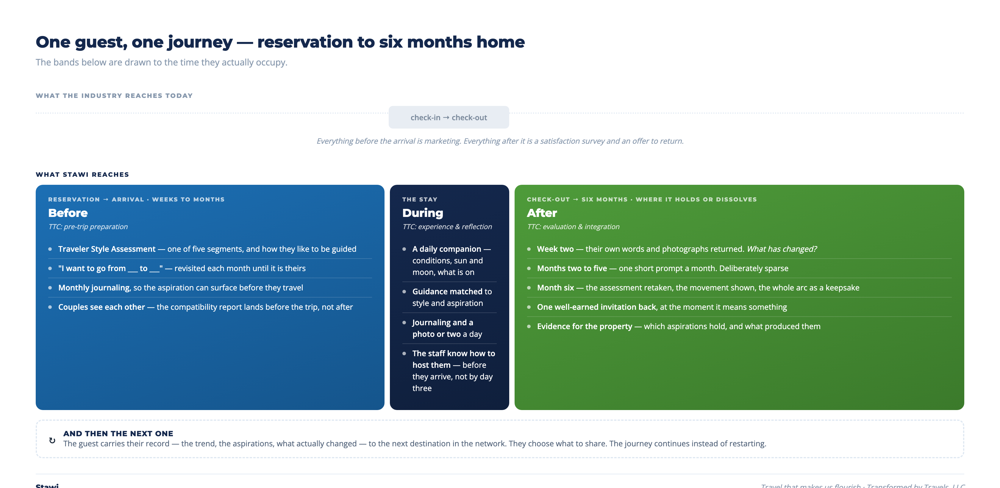

# The Stawi Transformation Platform

*Delivering travel that makes us flourish — across the whole arc of a journey, and a network of
destinations to continue it.*

*From Transformed by Travels, LLC*

---

## The shift

The visitor economy is moving from experiences to transformations. The Transformational Travel
Council's *2025 State of the Industry Report*, produced with Stone Mantel and Joseph Pine, puts
the transformation market at **$208 billion in the United States alone**, and identifies it as
the fastest-growing segment of the industry.

TTC frames the move as six shifts. Five of them are matters of strategy, language and design —
things a destination can decide to do and then do. One of them is different:

> **From acute trips to ongoing journeys.**
> *Travel has long focused on the time in the destination. Amplifying the value requires travel
> brands to extend engagement across pre-trip, in-destination, and post-trip touchpoints.*

That shift cannot be made by deciding to make it. It needs a strategy, a process and a system —
and until now the system hasn't existed. **That is what Stawi is.**

## The problem

Guests who come for transformation are harder to serve than visitors, and in ways a property
cannot see from the booking. Pine calls them *aspirants* — people who arrive wanting to become
something rather than simply to spend their time well. We'll keep calling them guests, because
that is what your team calls them, but the distinction is the whole problem.

They arrive with **aspirations the destination doesn't know** — often still unarticulated at
check-out. They have **styles** that shape how they want to be hosted. They carry **personal
burdens** they came partly to think through, and those change from visit to visit, which makes
fixed programming nearly impossible. They treat the trip as an **investment in their own
flourishing**. And they measure success by **meaning, not satisfaction** — a five-star survey can
sit alongside a trip that changed nothing.

The uncomfortable implication: **the stay itself is only a fraction of the outcome.** Most of
what determines whether a person is changed by a visit is tucked away inside them, and most of it
happens before they arrive and after they leave.

Earlier this year my wife and I stayed at a retreat that has committed itself fully to
transformational hospitality. It was beautiful and genuinely well delivered, down to a daily hour
set aside for meditation and reflection. But the program began at check-in and ended at
check-out. Everything we received afterwards was an offer to come back.

While the experience was near perfect, the transformation could have been a lot better. That is
not a criticism of the property — it is the industry's standard shape, and nobody has had the
tooling to do otherwise.

## What we have built

Stawi is a digital platform that helps destinations understand their guests and stay with
them across the whole arc — **from the moment of reservation to six months after check-out.**

It follows TTC's own prescription for a transformational experience to result in an actual
transformation:

| TTC's step | What Stawi does |
|---|---|
| **Pre-trip preparation** — uncovering motivation, setting intentions | Traveler Style Assessment, aspiration-setting, monthly journaling before arrival |
| **During-trip experience and ongoing reflections** | A daily microsite: conditions, guidance matched to the guest, journaling, photographs |
| **Post-trip evaluation and integration** | A six-month arc that returns their own words to them and measures what moved |

## Two axes, not one

A key assumption is that guests differ along **two independent dimensions**, and a destination
needs both.

**What they want to become.** Pine's four aspiration types — Refinement, Ambition, Cultivation,
Metamorphosis — and the role each asks the brand to play: Expert, Coach, Counselor, Alchemist.

**How they want to be guided there.** Our **Traveler Style Assessment (TSA)** places a guest in
one of five segments — Purpose Driven, Growth Seeker, Adventure Traveler, Cultural Explorer, or
Experience Seeker — each carrying its own attributes about how that person likes to travel.

These are not competing taxonomies. Shown the travel styles, Joseph Pine described them as well
aligned with his own framework and with what he has observed in the field — not the same, but
compatible. That distinction is exactly the point. The two sit perpendicular to each other, and
the combination is where the value sits. A Metamorphosis aspirant who is a Cultural Explorer needs a materially different week
from a Metamorphosis aspirant who is an Adventure Traveler — same aspiration, same brand role,
entirely different delivery. Nothing in the existing frameworks separates them.

The fifth segment deserves a word. Some guests just want a great and relaxing experience.
**Experience Seeker** is not a failed transformation — it is someone who wants *time well spent*
rather than *time well invested*, which is a perfectly good thing to want. Knowing that, and telling the property not to press, is as useful an output as any
of the others.

**On the instrument itself:** the TSA is a 25-question forced-choice assessment taking about five
minutes. Unlike a fixed-personality instrument, it measures what a person holds true at a point
in time — priorities move, and the assessment is designed to be retaken, producing a trend rather
than a label. To date it has been through **early pilot work with 25 participants, with
encouraging self-report results. Formal validation is planned.**

## Most people don't travel alone

Ask a couple why they booked, and a surprising number will tell you the trip is about each
other. Not the place, not the wildlife — the chance to be in the same room again, properly,
for the first time in a year. *From drifting apart to reconnected* is one of the most common
aspirations there is, and neither Pine's framework nor anyone else's accounts for it, because
both treat transformation as something that happens to an individual.

Stawi already handles pairs, and it is the part of the product furthest along.

When two guests travel together, each completes the assessment separately. Stawi then shows
**where they align and where they diverge, dimension by dimension** — curiosity, adventure,
reflection and the rest — and writes them a report in four parts:

- **Travel Chemistry** — how these two actually fit
- **Your Strengths as Travel Partners** — what they are already good at together
- **Where to Find Your Rhythm** — the honest part: where they will rub, and what to do about it
- **Trip Styles Made for You Both** — what suits the pair rather than either one

The divergences are the useful output, not the agreements. One partner wants to be out before
sunrise; the other wants a slow morning. One needs solo hours to recharge; the other reads that
as rejection. These are the small frictions that quietly spoil good trips, and a property that
knows about them in advance can design around them — separate early activity for one, a late
breakfast held for the other, and nobody has to negotiate it mid-vacation.

For the guests, seeing it written down before they travel does something a trip alone cannot:
it turns an unspoken difference into a thing they can talk about kindly.

## How it works

*The whole arc. The bands are drawn to the time each phase actually occupies.*

### Integration — deliberately light

Stawi is designed to sit beside a property's reservation system rather than inside it. The
property adds a **CC to the confirmation email**; changes and cancellations flow through the same
copies. Webhook and API integrations can follow once demand justifies them.

**Stawi is not a system of record.** It is not reservations, not property management, not
customer service. It is the layer that knows the guest.

### Before arrival

A microsite is created at the moment of reservation, **branded entirely as the destination's own**
— the traveler is the hero, and so is the property, not us.

It opens with an invitation to take the TSA and a one-page report on what it found. It introduces
the place: a welcome from the people who work there, what the climate will be doing, what will be
available. And it invites the guest to begin journaling — monthly, between booking and
arrival. Where that gap is short, at least one session is offered so the person can set their
aspirations before they travel.

When two people are traveling together, both are invited, and their compatibility report arrives
before the trip rather than after it. That timing matters. A couple who learn in week one that one
of them needs an hour alone each afternoon can plan around it; a couple who discover it on day
three of the trip have an argument instead. For many pairs this is the first time anyone has shown
them, side by side and without judgment, how differently they each want to travel — and the
conversation it starts is often part of what they came for.

### During the stay

From the day before arrival, the microsite becomes a daily companion:

- Conditions, sunrise and sunset, moonrise and moonset
- Guidance matched to aspiration and style
- Journaling at any moment
- What is happening on the property, and nearby options that suit this particular person
- A photograph or two a day — a record, not an album

### After the stay — where the transformation holds or dissolves

Pine's third obligation is follow-through, and it is the one the industry skips. A guest leaves
changed, returns to the life that shaped them, and within two weeks the change has quietly
dissolved. The destination never learns this, because the last contact was a satisfaction survey.

**About two weeks after check-out**, the guest receives their trip back: their own journal
entries, their photographs, the aspirations they set before arriving. Not a marketing piece —
their own words, returned at the moment the details start to fade. One question: *what, if
anything, has changed?*

**Months two to five** carry one short prompt a month. Under two minutes, always the same shape:
what you said you wanted, what has moved, what has not. Deliberately sparse — a destination that
appears too often in the inbox stops being a guide and becomes marketing.

**At six months**, the guest retakes the TSA. Because it measures a point in time rather than
fixed personality, the retake shows movement. Alongside it comes the whole arc — before, during,
after — as a single keepsake.

This is also what makes *meaning* measurable. The aspirations a person set in their own words,
against what they report half a year later. No other instrument in hospitality produces that.

The entire post-stay program is **opt-in**, offered at check-out rather than assumed, with a
one-click exit that ends it permanently. It is not a drip campaign wearing a different hat, and
the moment it feels like one it stops working.

## The network

The six-month arc ends. The aspiration usually doesn't.

Someone who went from running on empty to rested is often ready, a year later, for something
harder. Someone who came back from Uganda having discovered they can travel alone has a different
question the following season. Today each of those becomes a fresh search, a blank booking form,
and a property that knows nothing about them.

Stawi is built so a traveler can carry their journey from one destination to the next. The TSA
trend, the aspirations they have set and revised, the record of what actually changed — these
belong to the guest, not to any single property, and they travel with them. Each year they can
choose the next destination from the network and pick up where they left off.

**The guest owns the record and chooses what to share.** This is not properties exchanging
guest lists; it is a traveler arriving somewhere new already understood, because they decided to
be. Any destination can see what has been shared with it and nothing else.

What each side gets from the network:

- **The traveler** — a transformation that continues across years and places rather than resetting
  at every check-in.
- **The destination** — guests who arrive already understood, with a history worth building on,
  and access to a pool of guests actively looking for their next step.
- **The network** — the one thing in this category that compounds. Features can be copied. A
  traveler's multi-year record, held by the traveler, cannot.

The Transformational Travel Council's global community of destinations and practitioners is the
natural first network. TTC has the members; Stawi is the layer that lets an guest move between
them without starting again.

## What the destination gets

TTC's own research sets the prize for properties that make this shift:

> **A 20–40% premium on ADR · length of stay extended to 5–12 days · return rates of 30–60%**

For a 25-room property at 70% occupancy and a $400 average daily rate — roughly $2.5 million in
room revenue — a 20% ADR premium is on the order of **$500,000 a year**. Stawi is priced at a
small fraction of that.

Beyond the rate premium, a property receives:

- **One well-earned re-invitation**, at six months, when the guest is holding the record of
  what the visit did for them. A better moment than a February discount email.
- **Aggregate, de-identified patterns** across its own guests: which aspirations report lasting
  change, and which offerings produced it. Evidence for program design, not guesswork.

## Where we are

Stawi is in pilot. We are looking for a small number of founding properties who will use it
for a season and tell us honestly where it falls short — and who are willing to be studied
alongside their guests.

---

## In short

Transformation is not something a destination can deliver in the days a guest is on the property.
It starts when they decide to come, and it either holds or dissolves in the months after they
leave. Almost nothing in the industry reaches either end of that.

Stawi is the system for the whole arc. It learns who a guest is before they arrive and what they
hoped would be different. It gives your team something to act on rather than a satisfaction score
to read afterwards. It stays with the guest long enough to find out whether anything actually
changed. And when two people come together, it shows them each other — which, for a great many of
them, is the real reason they booked.

What the property gets is guests who arrive already understood, a reason to be remembered six
months later, and evidence of what its programming genuinely does to people. What the guest gets
is a trip that keeps working after they are home.

That is the shift the Transformation Economy asks for. This is the system that makes it possible.

---

### Notes for Michael, not for the document

1. **The retreat is anonymized.** If you want to name Wild Rice Retreat, tell them first — the
   paragraph is fair but it does say their follow-up is marketing offers, and they are a demo
   partner.
2. **The MBTI comparison is gone.** It invited a validity argument you do not need and cannot
   win, and your own psychology credential makes it more damaging rather than less. The TSA now
   stands on its own terms.
3. **The 25-participant line is now framed as pilot work.** Honest and unattackable.
4. **Pricing** is referenced but no number is given. Settle that with Jake first.
5. **Everything in quotation marks** is TTC/BVK's own language from the Shifts document, so this
   reads as part of their canon rather than a vendor pitching at them.
